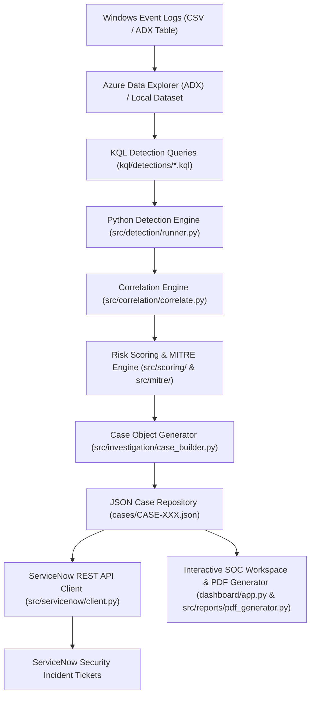

# SOC Investigation Platform

An automated Security Operations Center (SOC) investigation platform operating over Windows Security Events stored in Azure Data Explorer (ADX) or evaluated locally. The platform performs KQL detection, rolling-window correlation, analytical risk scoring, MITRE ATT&CK technique mapping, automated ServiceNow security incident ticketing, interactive log ingestion, and executive PDF reporting.

---

## Key Features

- **Automated KQL & Local Detection Engine:** Executes 5 modular KQL detections targeting Brute Force (`T1110`), Success After Failure (`T1078`), Suspicious RDP (`T1021.001`), Privilege Escalation (`T1098`), and Suspicious Source IPs (`T1090`).
- **Rolling-Window Correlation & Analytical Scoring:** Groups alerts by `(Account, Source IP)` across a 60-minute window, evaluates touchpoints on sensitive assets (`DC-01`), and maps risk scores to severity bands (`LOW`, `MODERATE`, `HIGH`, `CRITICAL`).
- **Automated ServiceNow Incident Ticketing:** Creates incidents in ServiceNow via REST API with complete payload mapping and idempotency checks (`find_existing` and work note updating).
- **Interactive SOC Workspace (Streamlit Dashboard):**
  - **Drag-and-Drop Log Ingestion:** Upload custom Windows Security Event Log CSV files directly in the web UI.
  - **On-Demand Pipeline Execution:** Trigger detection, correlation, and ServiceNow sync directly from the UI sidebar.
  - **Case Inspector & Timelines:** Detailed event timeline viewer, MITRE ATT&CK tags, IOC lists, and direct links to ServiceNow incidents.
- **Executive PDF Report Export:** One-click generation of formal, publication-ready PDF triage reports (`ReportLab` engine) containing executive metric summaries and case breakdowns.

---

## Architecture Diagram



---

## Case Walkthrough: `CASE-001` (`bob` Attack Chain)

Target account **`bob`** (`203.0.113.45`) demonstrates a complete multi-stage intrusion chain, and is the only case in the sample dataset where all five detections fire together:

1. **Brute Force Attempt (`T1110`)**: 8 failed RDP logons recorded on host `FILE-01`.
2. **Success After Failure (`T1078`)**: Successful authentication following repeated failures.
3. **Suspicious RDP Session (`T1021.001`)**: RDP interactive logon initiated from external non-private IP `203.0.113.45`.
4. **Privilege Escalation (`T1098`)**: User `bob` added to privileged group `Administrators` on Domain Controller `DC-01`.
5. **Suspicious Source IP (`T1090`)**: All of the above originate from an external, non-private address.
6. **Scoring & Triage**:
   - Total Risk Score: **16** (Severity: **CRITICAL**)
   - Verdict: **TRUE_POSITIVE**
   - Automatically created ServiceNow Security Incident: `sys_id: 079bf37dc3270310022c770d050131d9`.

---

## Quick Start & Usage

### 1. Installation
```bash
pip install -r requirements.txt
```

### 2. Configuration
Copy `.env.example` to `.env` and configure your ADX and ServiceNow PDI credentials:
```env
ADX_CLUSTER_URL=https://<your-cluster>.<region>.kusto.windows.net
ADX_DATABASE=soc
SERVICENOW_INSTANCE_URL=https://devXXXXX.service-now.com
SERVICENOW_USER=admin
SERVICENOW_PASSWORD=your_password
```

### 3. Launch Interactive SOC Workspace (Dashboard)
```bash
streamlit run dashboard/app.py
```
*In the sidebar, you can:*
- **Upload custom log CSV files** via drag-and-drop and click **"Analyze Uploaded Logs"**.
- **Trigger the pipeline** on-demand with **"Run Investigation Pipeline"**.
- **Download formal PDF reports** with **"Download PDF Executive Report"**.

### 4. Execute Pipeline via CLI (Alternative)
```bash
python src/main.py
```

### 5. Run Test Suite
```bash
pytest
```

---

## Documentation

- [Architecture Guide](docs/architecture.md)
- [Detection Methodology](docs/detection-methodology.md)
- [Investigation & Scoring Methodology](docs/investigation-methodology.md)
- [Setup Guide](docs/setup.md)

---

## Disclaimer

The risk-scoring model in this project (`config/scoring.yaml`) is a project-specific analytical scoring approach, not an industry-standard severity calculation. It exists to make triage decisions transparent and explainable, not to replace a vendor SOAR/SIEM's risk engine.
