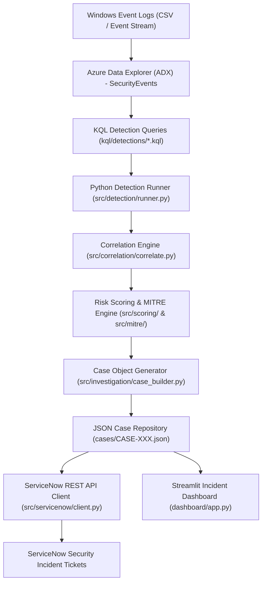

# Platform Architecture

## Stage Descriptions

1. **Log Storage & Querying:** Logs are ingested into Azure Data Explorer (ADX) database table `SecurityEvents` and queried using high-performance Kusto Query Language (KQL).
2. **Detection Layer:** Modular KQL detection queries target specific indicators (Brute Force, RDP logon, privilege escalation, success-after-failure).
3. **Correlation Engine:** Raw hits are grouped by account and external source IP across a rolling correlation time window.
4. **Analytical Risk Scoring & MITRE Mapping:** Calculates risk scores based on detection weights, sensitive asset touches (e.g. Domain Controller `DC-01`), assigns severity bands, and tags corresponding MITRE ATT&CK techniques.
5. **Investigation Case Objects:** Standardized JSON objects created for each correlated incident with timeline details and IOCs.
6. **ServiceNow Incident Integration:** Automatic creation and idempotent updating of ServiceNow security incident tickets.
7. **Streamlit Dashboard:** Interactive visual dashboard for SOC analysts to review active metrics, case details, timelines, and ServiceNow links.
